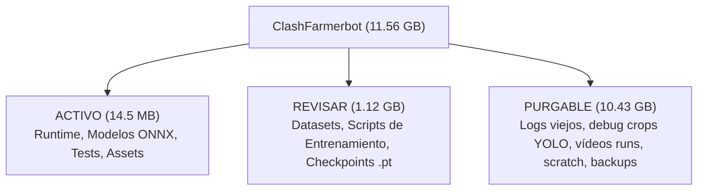

# Reporte de Auditoría y Plan de Limpieza (CLEANUP_REPORT.md)

**Fecha de auditoría:** 19 de noviembre de 2026  
**Proyecto:** ClashFarmerbot  
**Objetivo:** Inventario completo de archivos y carpetas, trazabilidad de dependencias/assets/modelos y estrategia de saneamiento seguro sin eliminación destructiva.

---

## 1. Resumen Ejecutivo

La auditoría exhaustiva del repositorio revela un volumen masivo de datos acumulados a lo largo de ciclos de desarrollo, experimentos de visión, entrenamientos y grabaciones de ataques en vivo:

* **Tamaño total del repositorio (excluyendo `.git` y `.venv`):** **~11,833.6 MB (~11.56 GB)**
* **Espacio clasificado como PURGABLE:** **~10,676.8 MB (~10.43 GB, 90.2% del peso total)**
* **Espacio clasificado como REVISAR (Datasets y Entrenamiento):** **~1,142.3 MB (~1.12 GB)**
* **Espacio clasificado como ACTIVO (Código runtime, modelos de inferencia, tests y assets):** **~14.5 MB (< 0.2%)**

> [!IMPORTANT]
> **Ningún archivo ha sido borrado.** Se ha creado la herramienta autónoma `scripts/safe_purge.py` para aislar lo purgables en `_quarantine/` únicamente cuando el usuario lo autorice explícitamente mediante `--execute`.

---

## 2. Inventario Exhaustivo de Carpetas y Archivos

A continuación se detalla el desglose métrico de todas las carpetas del repositorio, ordenadas por categoría y relevancia:

| Directorio / Ubicación | Cantidad de Archivos | Tamaño en Disco (MB) | Estado / Clasificación Principal |
| :--- | :---: | :---: | :--- |
| **`logs/`** | 2,756 | 8,757.51 MB | **PURGABLE** (99.8%) / ACTIVO (log actual) |
| **`runs/`** | 26 | 1,188.69 MB | **PURGABLE** (grabaciones raw) / REVISAR (checkpoints) |
| **`datasets/`** | 515 | 1,055.02 MB | **REVISAR** (Datos de entrenamiento YOLO y UNet) |
| **`scratch/`** | 347 | 796.68 MB | **PURGABLE** (Scripts y capturas de prueba) |
| **`models/`** | 6 | 176.88 MB | **ACTIVO** (ONNX) / **REVISAR** / **PURGABLE** (.pt) |
| **`tests/`** | 74 | 11.64 MB | **ACTIVO** (Suite de tests y fixtures) |
| **`ejemplos/`** | 4 | 9.11 MB | **REVISAR** (Capturas de referencia de cofres) |
| **`. (Archivos en Raíz)`** | 14 | 3.43 MB | **ACTIVO** (código) / **PURGABLE** (context dumps) |
| **`backups/`** | 115 | 1.75 MB | **PURGABLE** (Snapshot obsoleto nov-2026) |
| **`assets/`** | 88 | 0.99 MB | **ACTIVO** (templates) / **PURGABLE** (archive) |
| **`docs/`** | 18 | 0.94 MB | **ACTIVO** (Documentación técnica y arquitectura) |
| **`tools/`** | 56 | 0.71 MB | **REVISAR** (Scripts de dataset y entrenamiento) |
| **`attack/`** | 11 | 0.59 MB | **ACTIVO** (Lógica de despliegue y combate) |
| **`core/`** | 36 | 0.52 MB | **ACTIVO** (Máquina de estados, hardware y lógica central) |
| **`vision/`** | 34 | 0.67 MB | **ACTIVO** (Lectores de daño, recursos, OCR y CV) |
| **`.agents/`** | 66 | 0.32 MB | **ACTIVO** (Habilidades y configuraciones de agentes) |
| **`humanizer/`** | 6 | 0.01 MB | **ACTIVO** (Patrones heurísticos antidetect) |
| **`config/`** | 1 | 0.01 MB | **ACTIVO** (`settings.json` canónico) |
| **`scripts/`** | 1 | 0.01 MB | **ACTIVO** (`safe_purge.py`) |
| **`_backups/`** | 0 | 0.00 MB | *No existe en el repositorio* |
| **`_trash*`** | 0 | 0.00 MB | *No existe en el repositorio* |

---

### Detalle de Subdirectorios Críticos

#### A. Desglose en `logs/` (Total: 8,757.51 MB | 2,756 archivos)
* `logs/yolo/`: **1,942 archivos | 6,730.81 MB** — Inferencia visual intermedia y depuración frame a frame generada en sesiones de desarrollo pasadas. (*Purgable*)
* `logs/runs/`: **349 archivos | 1,624.29 MB** — Capturas completas de ataques y progresos de batalla archivados. (*Purgable*)
* `logs/diagnostics/`: **22 archivos | 101.79 MB** — Pruebas de diagnóstico de pantalla completa. (*Purgable*)
* `logs/debug_captures/`: **25 archivos | 42.33 MB** — Capturas puntuales de debugging de OCR y popups. (*Purgable*)
* `logs/tooltips/`: **14 archivos | 19.76 MB** — Capturas de calibración de tooltips de recursos. (*Purgable*)
* `logs/fails/`: **202 archivos | 0.86 MB** — Recortes de fallos de matching pasados. (*Purgable*)
* `logs/findings/`: **1 archivo | 0.01 MB** (*Purgable*)
* `logs/*.png`, `logs/*.jpg` en raíz de logs: **185 archivos | 225.55 MB** (*Purgable*)
* `logs/*.json`, `logs/*.md`: **13 archivos | 0.76 MB** (*Purgable*)
* `logs/clash_bot.log.1`, `logs/clash_bot.log.3`: **2 archivos | 10.00 MB** — Logs rotados antiguos. (*Purgable*)
* `logs/clash_bot.log`: **1 archivo | 1.35 MB** — Log de ejecución activo. (**ACTIVO**)

#### B. Desglose en `runs/` (Total: 1,188.69 MB | 26 archivos)
* Grabaciones de video de batalla (`.h264`, `.mp4`, `.mkv`):
  * `runs/mission_attacks_live.h264`: **343.75 MB** (*Purgable*)
  * `runs/mission_attacks_live.mp4`: **343.75 MB** (*Purgable*)
  * `runs/mission_attacks_run2.mkv`: **282.75 MB** (*Purgable*)
  * `runs/test_extract.h264`: **49.90 MB** (*Purgable*)
* `runs/detect/`: **21 archivos | 92.27 MB** — Salidas de visualización de YOLO. (*Purgable*)
* `runs/wall_unet_best.pt`: **76.28 MB** — Pesos de entrenamiento de UNet. (**REVISAR**)
* `runs/segment/`: **0 archivos | 0.00 MB**

#### C. Desglose en `scratch/` (Total: 796.68 MB | 347 archivos)
* Carpetas de extracción y previews (`coc-deploy-zone-finder`: 148 MB, `wall_prelabels_preview`: 198.5 MB, `video_analysis`: 90.5 MB, `wall_unet_mask_preview`: 88.8 MB, `clash-of-clans-vision`: 32.8 MB).
* Decenas de scripts `.py` y `.js` de descifrado, pruebas de pan/zoom y experimentos fuera del flujo productivo. (*Todo Purgable*)

#### D. Desglose de Archivos en Raíz (`.`) (Total: 3.43 MB | 14 archivos)
* `main.py` (1.1 KB) — Punto de entrada del bot. (**ACTIVO**)
* `repomix.config.json` (1.3 KB) — Configuración de empaquetado. (**ACTIVO**)
* `requirements.txt` (26 B), `requirements-runtime.txt` (90 B) — Dependencias productivas. (**ACTIVO**)
* `requirements-train.txt` (128 B) — Dependencias para entrenar modelos. (**REVISAR**)
* `.env`, `.env.example`, `.gitignore` — Entorno y control de versiones. (**ACTIVO**)
* `gu_a_maestra_de_prompts_para_agy.md` (5.0 KB) — Guía de prompts. (**REVISAR**)
* **Archivos masivos de contexto autogenerados:**
  * `proyecto_contexto.txt` (1.78 MB) (*Purgable*)
  * `clashfarmerbot_context.md` (0.56 MB) (*Purgable*)
  * `muros_context.md` (0.56 MB) (*Purgable*)
  * `core_vision_contexto.txt` (0.31 MB) (*Purgable*)
  * `muros_only.md` (0.21 MB) (*Purgable*)

---

## 3. Trazabilidad de Dependencias, Modelos y Assets

Se realizó un escaneo profundo de imports, cadenas y referencias en `main.py`, `core/`, `attack/`, `vision/`, `humanizer/`, `config/settings.json` y la suite de pruebas `tests/`:

### A. Modelos en `models/` (Total: 6 modelos | 176.88 MB)

| Modelo | Tamaño | Estado | Justificación y Referencias |
| :--- | :---: | :---: | :--- |
| **`models/deploy_zone_finder.onnx`** | 73.91 MB | **ACTIVO** | Utilizado por `vision/deploy_zone_detector.py`, `config/settings.json` y validado en `tests/test_deploy_zone_detector.py`. |
| **`models/wall_seg.onnx`** | 25.27 MB | **ACTIVO** | Modelo ONNX de segmentación de muros. Utilizado por `vision/wall_seg_detector.py`, `config/settings.json` y validado en `tests/test_wall_compartments.py` y `test_wall_unet_pipeline.py`. |
| **`models/yolov8s.onnx`** | 43.16 MB | **ACTIVO** | Detector principal de edificios de la aldea. Utilizado por `vision/yolo_detector.py`, `core/config.py` y `config/settings.json`. |
| **`models/yolov8n-seg.pt`** | 6.74 MB | **REVISAR** | Checkpoint base de Ultralytics para segmentación. Referenciado exclusivamente en `tools/train_wall_seg.py`. |
| **`models/yolov8s.pt`** | 21.54 MB | **REVISAR** | Checkpoint base de Ultralytics para detección. Referenciado en `tools/train_yolo.py`. |
| **`models/yolov8n.pt`** | 6.25 MB | **PURGABLE** | Checkpoint nano estándar de YOLOv8. No posee ninguna referencia en runtime, tests ni scripts de entrenamiento del bot. |

### B. Plantillas y Botones en `assets/` (Total: 88 archivos | 0.99 MB)

* **En uso Runtime / Tests (76 archivos):**
  * `assets/buttons/` (55 activas): Botones de ataque, surrender, return home, constructores, filtros, mejoras de muros y modales (`attack_btn.png`, `return_home.png`, `claim_reward_btn.png`, `wall_label_generic.png`, `filter_gold_off.png`, `filter_perm_off.png`, `build_btn.png`, etc.).
  * `assets/digits/` (10 archivos: `0.png` a `9.png`): Cargados dinámicamente mediante bucle `range(10)` en `vision/resource_reader.py`.
  * `assets/digits_damage/` (11 archivos: `0.png` a `9.png` y `%`): Cargados dinámicamente por `vision/damage_reader.py`.
* **Obsoletos / Descontinuados (12 archivos):**
  * `assets/_archive_buttons/` (8 archivos | 0.08 MB): Botones antiguos de chat, confirmación de muros legacy y modales reemplazados (`chat_close_tab.png`, `wall_row_item_old_backup.png`, etc.). (*Purgable*)
  * `assets/custom_templates/` (2 archivos | 0.04 MB): `c_elixir.png`, `c_gold.png` de experimentos preliminares. (*Purgable*)
  * `assets/buttons/attack_btn_chest.png` y `chest_rolling_pins.png` (2 archivos): Variantes descartadas en favor de `tpl_chest_indicators`. (*Purgable*)

### C. Scripts en `tools/` (Total: 35 scripts | 0.71 MB)

Los scripts de `tools/` no intervienen en el bucle autónomo en vivo (`main.py`), sino en pipelines de soporte offline:
* **Entrenamiento (REVISAR):** `train_wall_unet.py`, `train_wall_seg.py`, `train_yolo.py`.
* **Etiquetado y Procesamiento de Datasets (REVISAR):** `json_to_wall_mask.py`, `prelabel_hsv.py`, `prelabel_walls_from_grafo.py`, `prelabel_with_model.py`, `split_dataset.py`, `auto_capture_villages.py`, `annotate_best_jump.py`.
* **Herramientas de Diagnóstico y Calibración (REVISAR):** `calibrate_jump_footprint.py`, `diagnose_drop_points.py`, `evaluate_jumps_offline.py`, `audit_village_diversity.py`.
* **Pruebas Ad-hoc de laboratorio (PURGABLE / REVISAR):** `test_stitch.py`, `test_sweep.py`, `test_canonical_diamond.py`, `test_live_wall_attack.py`.

---

## 4. Clasificación Definitiva de Elementos



### [ACTIVO] — Componentes Críticos del Bot (No tocar)
* `main.py`, `core/`, `attack/`, `vision/`, `humanizer/`, `config/settings.json`.
* `models/deploy_zone_finder.onnx`, `models/wall_seg.onnx`, `models/yolov8s.onnx`.
* `assets/buttons/` (excepto archive), `assets/digits/`, `assets/digits_damage/`.
* `tests/` (los 23 archivos de test y los 6 fixtures de `tests/fixtures/`).
* `.agents/`, `docs/`, `requirements.txt`, `requirements-runtime.txt`, `.env*`.
* `logs/clash_bot.log` (archivo de log principal en ejecución).

### [REVISAR] — Datos y Herramientas Offline (Conservar para reentrenamiento)
* `datasets/` (`coc/`, `coc_walls/`, `coc_walls_raw/`, `coc_walls_unet/` — 1,055 MB).
* `tools/train_*.py` y herramientas de etiquetado/calibración de datasets.
* `models/yolov8n-seg.pt` (6.74 MB), `models/yolov8s.pt` (21.54 MB).
* `runs/wall_unet_best.pt` (76.28 MB).
* `ejemplos/` (4 capturas de referencia, 9.11 MB).
* `requirements-train.txt`.

### [PURGABLE] — Basura, Depuración Antigua y Temporales (Mover a `_quarantine/`)
* **`logs/` (> 8,746 MB):**
  * `logs/yolo/` (1,942 archivos | 6,730.81 MB).
  * `logs/runs/` (349 archivos | 1,624.29 MB).
  * `logs/diagnostics/`, `debug_captures/`, `tooltips/`, `fails/`, `findings/`.
  * Todas las capturas `.png`/`.jpg` e informes `.json` sueltos en la raíz de `logs/` (185 archivos | 225.55 MB).
  * Logs rotados antiguos `logs/clash_bot.log.1`, `clash_bot.log.3` (10 MB).
* **`runs/` (> 1,112 MB):**
  * Grabaciones `.h264`, `.mp4`, `.mkv` (`mission_attacks_live.*`, `mission_attacks_run2.mkv`, `test_extract.h264` — 1,020.15 MB).
  * `runs/detect/` (92.27 MB).
* **`scratch/` (> 796 MB):**
  * Todos los 347 archivos y subcarpetas temporales.
* **`backups/` (1.75 MB):**
  * `backup_jump_optimizer_20261114_170528/`.
* **Assets descontinuados:**
  * `assets/_archive_buttons/`, `assets/custom_templates/`.
* **Modelos sin uso:**
  * `models/yolov8n.pt` (6.25 MB).
* **Archivos masivos de contexto en raíz (~3.42 MB):**
  * `proyecto_contexto.txt`, `core_vision_contexto.txt`, `clashfarmerbot_context.md`, `muros_context.md`, `muros_only.md`.

---

## 5. Script de Aislamiento y Control: `scripts/safe_purge.py`

Se ha creado el script [`scripts/safe_purge.py`](file:///c:/ClashFarmerbot/scripts/safe_purge.py) con las siguientes garantías:

1. **Modo seguro por defecto (`--dry-run`):** Muestra detalladamente los 3,258 archivos identificados (~10,676.80 MB) sin alterar el disco.
2. **Modo aislamiento (`--execute`):** Mueve cada elemento purgable preservando su estructura relativa hacia `_quarantine/` (sin usar `rm` permanente).
3. **Persistencia de directorios runtime:** Recrea automáticamente `logs/` y `runs/` vacíos para evitar excepciones en handlers de logging o procesos concurrentes.
4. **Blindaje en `.gitignore`:** Añade reglas para evitar volver a versionar o acumular en el futuro:
   ```gitignore
   _quarantine/
   _trash*/
   _backups*/
   *.h264
   *.mkv
   *.mp4
   *_context.md
   muros_context.md
   muros_only.md
   ```

### Instrucciones de Ejecución

Para auditar y simular la limpieza (sin mover nada):
```powershell
python scripts/safe_purge.py
```

Para aplicar la cuarentena segura y liberar 10.43 GB de espacio:
```powershell
python scripts/safe_purge.py --execute
```
